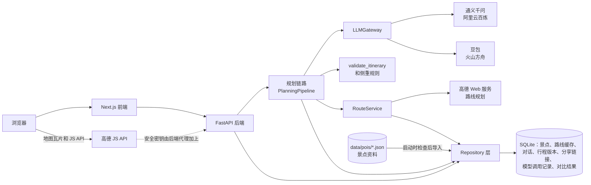
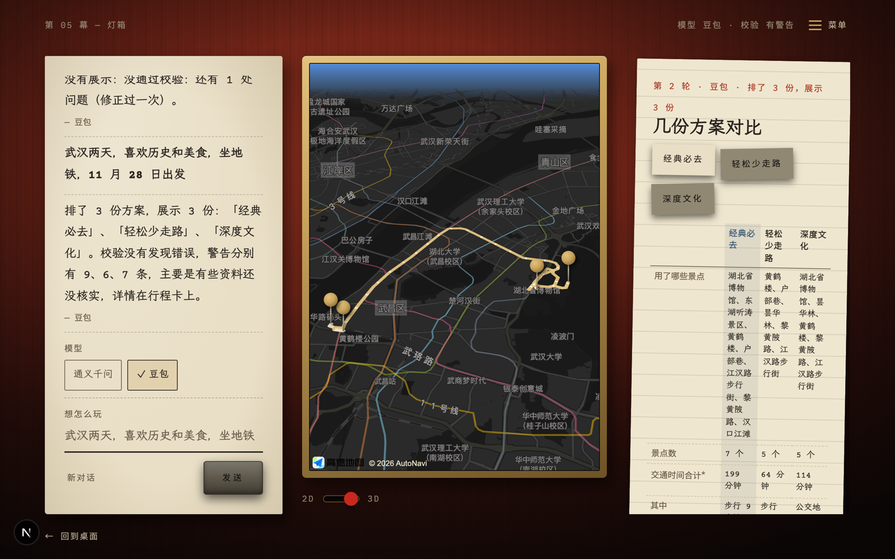
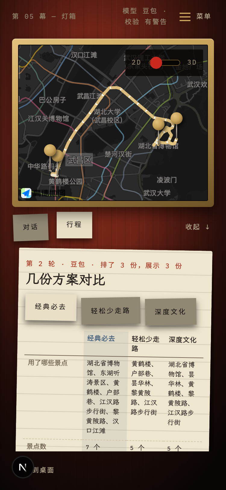
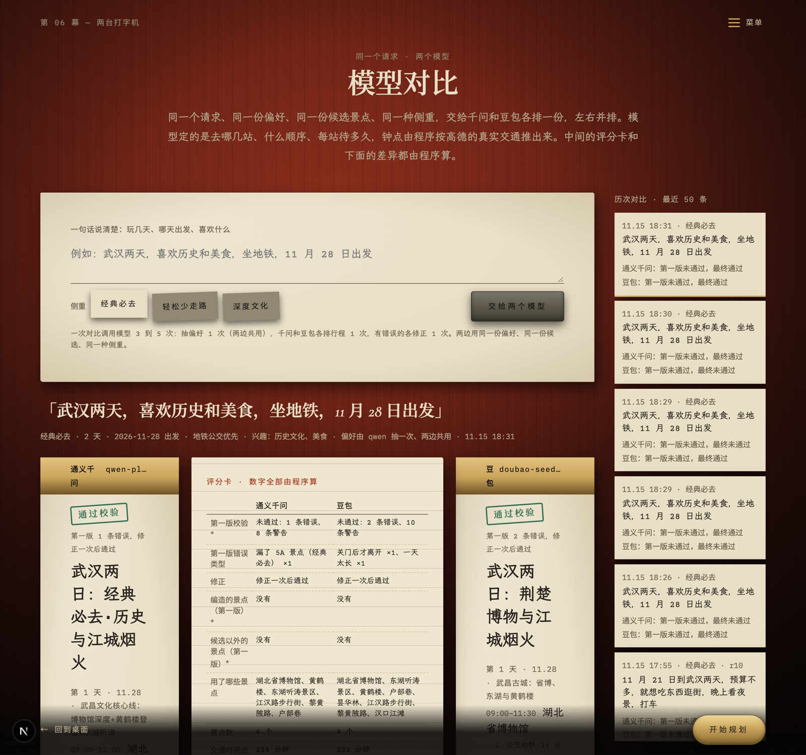

# 武汉记忆 WuhanMemory

用日常的话说想怎么玩武汉，得到一份画在地图上、经过程序校验的逐日行程。

这是 Cecilia 的个人项目：需求、设计决定和验收由 Cecilia 负责，代码是和 AI 编程助手（Claude）一起写的。开发过程记在 [`docs/progress/dev-log.md`](docs/progress/dev-log.md)，每个技术决定有一条 ADR（[`docs/adr/`](docs/adr/)）。

## 解决什么问题

让大模型排旅游行程很容易，但它说的开放时间、两地之间走多久、某个景点存不存在，都可能是编的，而且看起来很像真的。这个项目的做法是分工：

- **模型只做它擅长的**：听懂用户的话（几天、哪天、喜欢什么、走路多不多），在给定的候选景点里挑景点、定顺序和每站待多久。
- **事实都由程序给**：景点资料来自有来源、有核实日期的景点库；交通时间来自高德路线规划；每站几点到、几点走由程序按真实交通推出来。
- **给用户看之前先校验**：`validate_itinerary` 用结构化数据核对每一站。有错误就把错误交给模型修正一次，还不通过就不展示行程，只列出问题。

## 主要功能（都已经做出来）

| 页面 | 做什么 |
|---|---|
| 地图工作台 `/map` | 左边对话，中间高德地图（2D / 3D 切换），右边行程卡。一句话排出三份侧重不同的方案（经典必去、轻松少走路、深度文化），可以切换、比较。每站显示开放时间、预约、门票、支付和资料的核实状态；每段交通显示方式、真实分钟数和查询日期。可以在千问和豆包之间切换模型。排好后可以直接生成分享链接 |
| 地点档案 `/places`、`/places/[id]` | 10 个景点的资料。每条信息写明来源、核实方式、核实日期和有效期，并标出"已核实""待确认""已过期" |
| 模型对比 `/compare` | 同一个请求、同一份偏好和候选，交给千问和豆包同时排，左右并排看两份行程和程序算出的指标；历次对比可以回看 |
| 我的行程 `/trips` | 排过的行程和它们的每个版本，可以打开、生成或撤回分享链接 |
| 分享页 `/s/[slug]` | 只读的明信片：地图、逐日行程、景点信息、校验结果、所用模型。链接指向固定版本，原行程以后再改也不影响它 |

另外：

- 数据检查脚本 `corepack pnpm check:data`：缺坐标、缺来源、会变的信息缺核实时间或过期时间等，都会报出来。
- 批量评测脚本 `corepack pnpm eval:run`：一组请求分别交给两个模型，输出 CSV 和汇总。
- 顺序重排效果 `corepack pnpm eval:order`：用已存的行程和缓存的路线，比较模型的顺序和程序重排后的路上时间（不调用模型和高德）。
- 公开模式：给别人用时，在后端 `.env` 里打开 `PUBLIC_MODE`，见下面"本地运行"。

## 架构



几条边界：

- 模型都经过 `LLMGateway`（[`apps/api/app/services/llm/`](apps/api/app/services/llm/)），业务代码不直接调用某一家的接口。超时、重试、限流等待、输出不合格时让模型重答，都在网关里。
- 地图经过 provider 接口（[`packages/map-core`](packages/map-core/)），页面不直接碰高德的对象。
- 数据库读写经过 repository 层（[`apps/api/app/repositories/`](apps/api/app/repositories/)），SQL 只在这里。现在用 SQLite（ADR 0003），以后可以换 PostgreSQL。
- 浏览器只拿得到高德 JS key。高德安全密钥、Web 服务 key、千问和豆包的 key 都只在后端的 `.env` 里，不提交到 git。

更详细的说明：[系统架构](docs/architecture/system-architecture.md)、[AI 规划链路](docs/architecture/ai-planning-pipeline.md)、[数据模型](docs/architecture/data-model.md)、[接口](docs/architecture/api-contracts.md)、[模型网关](docs/architecture/llm-provider-gateway.md)。

## 技术栈

- 前端：Next.js（App Router）、React、TypeScript、CSS Modules。字体都放在项目里，不依赖国外的字体服务。
- 后端：FastAPI、Python、Pydantic、httpx。
- 数据：JSON 种子文件（`data/pois/`）+ SQLite。
- 地图和路线：高德 JS API 2.0（`@amap/amap-jsapi-loader`）、高德 Web 服务路径规划 2.0（步行、公交地铁、驾车）。
- 模型：通义千问 `qwen-plus`、豆包（火山方舟推理接入点），都走 OpenAI 兼容接口。
- 工程：pnpm monorepo（`apps/web`、`apps/api`、`packages/shared`、`packages/map-core`），后端测试用 pytest。

## 数据质量规则

每个景点一个 JSON 文件（[`data/pois/`](data/pois/)），每一条信息（地址、开放时间、票价、预约、支付、交通、拍照机位、周边美食……）单独记录：

- `verification`：实地核实 / 核对过来源 / 占位 / TODO；
- `sourceId`：指向文件开头的来源列表（标题、链接、查阅日期、来源类型）；
- `lastCheckedAt`：上次核实的日期；
- 会变的信息还有 `expiresAt`：开放时间和预约最长 90 天，票价、支付、周边美食 180 天，交通 365 天。

检查脚本强制执行：缺坐标、坐标不在武汉范围、缺来源、缺核实日期或过期日期、有效期超过上限、自己的照片文件不存在，都是错误，这个景点不能导入数据库；已过期是警告，照样导入，但页面上标"已过期"。检查脚本有测试：一份合格的虚构样例加 12 份各错一处的数据，每一份都必须被查出来。

**现在的资料情况（如实说明）**：10 个景点的资料来自景点官网、政府网站、旅游平台、媒体报道，以及用豆包整理后再核对来源的资料包。Cecilia 还没有去实地核实，所以"实地核实"是 0 条。按最近一次评测时程序数出来的数字，185 条信息里：核对过来源 157 条、占位 16 条、TODO 12 条。"核对过来源"里有不少来源程序打不开（例如携程拒绝程序访问），没有核对过原文，详见 [`docs/progress/current-progress.md`](docs/progress/current-progress.md)。照片都是占位，不提交到 git，网站公开前必须换成自己拍的。

完整规则见 [`docs/architecture/data-model.md`](docs/architecture/data-model.md)。

## 行程是怎么生成和校验的

1. **抽偏好**（模型）：从一句话里抽出天数、日期、节奏、兴趣、预算、同行人、交通偏好、必去、不去。缺天数或日期时反问用户，其余没说的用默认值，并写明"按默认"。
2. **筛候选**（程序）：从景点库里选，去掉用户说不去的和暂停开放的。模型只能用候选里的景点。
3. **三种侧重**（程序定规则）：经典必去（5A 景点都要去；用户点名了必去时以用户的为准）、轻松少走路（每天最多 3 站、17:30 前结束、步行合计不超过 2 公里）、深度文化（只排文化类景点、每站停留不少于建议时长）。三份同时交给模型排。
4. **排行程**（模型）：每天几点出发、去哪几站、什么顺序、每站待多久。提示词里有候选两两之间的真实交通时间。
4½. **重排顺序**（程序，2026-11-18，[ADR 0010](docs/adr/0010-program-orders-stops.md)）：每一天内部穷举所有顺序（最多 8 站），换成相邻两站真实交通分钟数之和最少的那个；第一站不固定；新顺序这一天的校验错误不能比模型的顺序多。行程卡上写明换没换、少了多少分钟。
5. **查交通、推钟点**（程序）：相邻两站用高德查真实交通（步行 15 分钟以内走路，否则按偏好坐公交地铁或打车）；到达时间 = 上一站离开 + 交通时间 + 10 分钟，往后取整到 5 分钟，早到了等开门。
6. **校验**（程序，`validate_itinerary`）：景点存不存在、到达时开没开门、是不是闭馆日、过没过最晚入场、关门前能不能离开、每天总时长是否超过节奏上限、交通查没查到、侧重的规则，以及用到的资料有没有过期、是不是待确认。分"错误"和"警告"两级；资料没写不等于闭馆，所以缺资料是警告，不算错误。
7. **修正**（模型 + 程序）：有错误时，把每条错误、程序推出的钟点和真实交通交给模型修正一次，再推钟点、再校验。
8. **展示和保存**：没通过的不展示，只列出问题；三份里几乎一样的只留一份。每份存成一个不可变的版本，带模型名、校验结果、修正轮数和当时的景点资料快照。

为什么钟点由程序推：第一次评测里两个模型最多的错误都是"交通时间不够"；把真实交通时间写进提示词以后，这类错误几乎没有减少（模型留的空档多是 15、20、30 分钟这样的整数）。所以改成模型只定顺序和停留时长，钟点由程序算（[ADR 0007](docs/adr/0007-program-computes-times.md)）。

## 双模型评测

**做法**（[ADR 0006](docs/adr/0006-model-comparison-same-inputs.md)）：两边的输入只差模型。批量评测用手写的偏好（不让模型抽，免得两边抽得不一样）、同一份候选、同一种侧重、同一份交通缓存，两个模型同时调用。指标全部由程序算：第一版有没有错误、错误类型、修正后有没有错误、有没有编造景点（id 在景点库里找不到）、有没有用候选以外的景点、耗时、token。"通过"指没有错误；警告不算，因为资料还没实地核实，几乎每份行程都有警告。请求在 [`eval/requests.json`](eval/requests.json)（10 条，Claude 起草，Cecilia 看过后没有改）。

**结果**：结果文件由脚本生成后原样提交，在 [`eval/results/`](eval/results/)。三次运行之间链路改过，所以三次的数字不能直接放在一起比。

| 运行 | 链路 | 首次通过（千问 / 豆包） | 修正后通过（千问 / 豆包） |
|---|---|---|---|
| [第一次](eval/results/2026-11-15.md)，每个模型 10 次 | 模型自己写钟点，提示词里只有直线距离 | 2/10、3/10 | 4/10、7/10 |
| [第二次](eval/results/2026-11-15-2.md)，每个模型 30 次 | 提示词里加了真实交通表 | 5/30、9/30 | 15/30、18/30 |
| [第三次](eval/results/2026-11-15-3.md)，每个模型 10 次 | 钟点由程序推 | 3/10、5/10 | 8/10、9/10 |

两个模型都没有用候选以外的景点。按定义（id 在景点库里找不到）只出现过 3 次"编造景点"，都在第二次运行的豆包：把黄鹤楼的 id `yellow-crane-tower` 拼成了 `yellow-crape-tower`，是写错了真实景点的 id，不是凭空编出一个地方。第三次剩下的错误主要是：千问漏了经典必去要求的 5A 景点、把湖北省博物馆排在周一闭馆日；豆包一天排得太长、关门后才离开。第三次之后改过一条规则（用户点名了必去时，经典必去不再强求所有 5A，见 ADR 0005 的更新），还没有重跑。

**顺序重排的效果**（[`eval/results/route-order-2026-11-18.md`](eval/results/route-order-2026-11-18.md)，`corepack pnpm eval:order` 生成，不调用模型和高德）：用开发数据库里存下的行程、模型原样给的顺序和缓存的高德路线算，199 个能比较的天里程序换了 124 天的顺序，路上的分钟数合计少 10.1%（16226 → 14595）；换了顺序的天，每天少的比例中位数 11.7%、最多 43.8%。三次批量评测都在重排之前，还没有重跑。

**局限**：只有 10 条请求、10 个景点，大多每条只跑了一次；指标只看程序能检查的东西，看不出行程好不好玩。所以评测汇总里不下"哪个模型更好"的结论。

## 本地运行

需要：Node.js（用 corepack 启用 pnpm）、Python 3.11 以上；高德开放平台的 Web 端 JS key（带安全密钥）和 Web 服务 key；阿里云百炼的千问 key；火山方舟的豆包 key 和推理接入点 ID。

```bash
# 1. 前端依赖
corepack pnpm install

# 2. 后端虚拟环境和依赖
cd apps/api
python3 -m venv .venv
.venv/bin/pip install -e ".[dev]"
cd ../..

# 3. 环境变量：复制模板后填 key（这两个文件不会提交到 git）
cp apps/api/.env.example apps/api/.env
cp apps/web/.env.example apps/web/.env.local
```

启动（两个终端窗口）：

```bash
corepack pnpm dev:api   # 后端 http://localhost:8000，启动时检查并导入 data/pois/
corepack pnpm dev       # 前端 http://localhost:3000
```

检查和测试：

```bash
corepack pnpm check:data   # 景点资料检查
corepack pnpm test:api     # 后端测试（不调用真实接口）
corepack pnpm typecheck    # 前端类型检查
corepack pnpm build        # 前端构建
corepack pnpm llm:smoke    # 千问和豆包各发一条请求（真实调用，花一点 token）
corepack pnpm eval:run     # 批量评测（真实调用，先跑 routes:prewarm 预热路线）
corepack pnpm eval:order   # 顺序重排的效果（只读数据库和路线缓存）
```

**公开模式**（给别人用时）：在 `apps/api/.env` 里设 `PUBLIC_MODE=true` 和 `OWNER_PASSCODE`，重启后端。打开后占位照片不对外；我的行程、生成和撤回分享链接要口令；规划和对比限次数（默认每个地址每小时 5 次、全站每天 50 次）。见 [ADR 0008](docs/adr/0008-public-mode.md)。

## 截图

2026-11-15 在本机开发环境截的，数据是开发数据库里真实排出来的行程和对比（豆包，"武汉两天，喜欢历史和美食，坐地铁"）。怎么截的写在 [`docs/screenshots/README.md`](docs/screenshots/README.md)。

**地图工作台**：左边对话，中间地图上是第 1 天的路线，右边是三份方案的对比卡。



**行程卡的一天**：时间线、开放时间、预约、门票，没资料的写"待补充"；两站之间是高德查到的真实交通。


**手机上的地图工作台**：地图在上，行程在下。



**模型对比**：同一个请求交给千问和豆包，中间的评分卡由程序算。



**地点档案**：每个条目下面写来源、核实日期。


**分享页**：明信片和地图，指向固定的版本。


**我的行程**：一段对话下面的几份方案和版本，没通过校验的不能分享。


## 计划中（还没做）

- 地点档案和首页的立体场景（胶卷、晾片、纸页三幕，桌面全景），设计样片在 `docs/design/prototypes/`（板块 1B）。现在是普通网页版，以后它仍是手机端和无障碍的版本。
- 实地核实景点资料，换上自己拍的照片。
- 规划的更多能力：更多偏好（例如住在哪一带）、取舍和风险提示、吃饭和休息时间、在一份方案上继续改、每站理由的依据、每站可以换成的景点。
- 网站上线，让老师和朋友能打开（几种办法正在比较）。
- 登录和账户：现在没有登录，公开模式下靠一个口令区分网站主人。

## 文档入口

- 开工说明和分板块计划：[`docs/kickoff/claude-code-kickoff.md`](docs/kickoff/claude-code-kickoff.md)
- 当前进度：[`docs/progress/current-progress.md`](docs/progress/current-progress.md)；开发日志：[`docs/progress/dev-log.md`](docs/progress/dev-log.md)
- 设计规范：[`docs/design/design-system.md`](docs/design/design-system.md)
- 给代码助手看的说明：[`AGENTS.md`](AGENTS.md)、[`PROJECT_MEMORY.md`](PROJECT_MEMORY.md)
