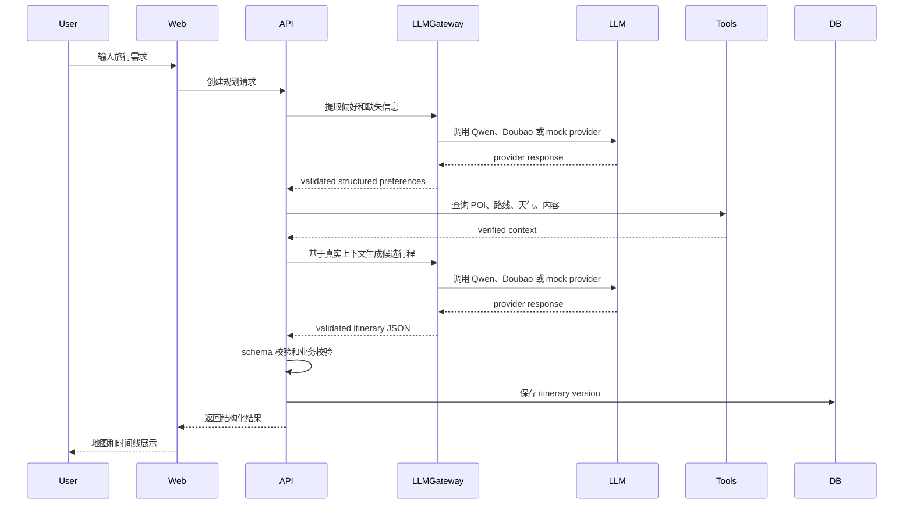

# AI Planning Pipeline

## 目标

AI 规划必须输出可验证、可地图渲染、可分享的结构化行程，而不是一段无法执行的旅行建议。

## 输入

用户输入包括:

- 目的地: 例如武汉。
- 日期和天数: 例如 2026-10-01 到 2026-10-04。
- 兴趣偏好: 历史文化、美食、夜景、摄影、亲子、博物馆、轻松游等。
- 交通偏好: 地铁优先、少走路、可打车、自驾。
- 预算: 低、中、高或具体金额。
- 同行人: 独自、情侣、朋友、亲子、老人。
- 特殊约束: 无障碍、避开排队、雨天备选、必须去/不想去的景点。

## 流程



## AI 工具列表

### `search_pois`

按城市、关键词、分类、标签、适合人群、半径查询 POI。

### `get_poi_detail`

获取景点坐标、简介、开放时间、票务、预约、建议游玩时长、来源和更新时间。

### `get_routes`

查询多个点之间的步行、公交/地铁、驾车或打车耗时。

### `get_weather`

查询目标日期天气预报或历史季节性天气建议。

### `retrieve_content`

从内部内容库和向量检索中提取历史文化、拍照机位、注意事项和评价摘要。

### `validate_itinerary`

验证时间冲突、跨城错误、路线过长、景点闭馆、预算约束、无来源数据。

### `publish_share_page`

为确认后的行程版本生成只读分享页面。

## LLM Provider 支持

AI 编排层必须通过 `LLMGateway` 调用模型，不能直接依赖具体厂商 SDK。

支持 provider:

- `qwen`: 阿里云百炼/Model Studio Qwen。
- `doubao`: 火山方舟豆包。
- 2026-11-15（板块 4）：`mock` 已移出应用代码，测试用 `apps/api/tests/llm_fakes.py` 里的假 provider。网关现在的样子见 `llm-provider-gateway.md`。

provider 模式:

- `fixed`: 固定 provider。
- `fallback`: 主 provider 失败时切到备用 provider。
- `shadow`: 主 provider 返回结果，备用 provider 异步对比质量。

## 结构化输出草案

```json
{
  "city": "武汉",
  "dateRange": {
    "start": "2026-10-01",
    "end": "2026-10-04"
  },
  "travelerProfile": {
    "pace": "moderate",
    "interests": ["history", "food", "photography"],
    "transportPreference": "metro_first",
    "budgetLevel": "medium"
  },
  "days": [
    {
      "dayNumber": 1,
      "theme": "江汉路与汉口历史街区",
      "items": [
        {
          "type": "poi",
          "poiId": "poi_123",
          "startTime": "09:30",
          "endTime": "11:00",
          "reason": "适合历史建筑和街拍",
          "photoTips": ["清晨低角度拍建筑立面"],
          "reservationTips": [],
          "paymentTips": ["地铁可使用支付宝、微信或武汉通"]
        },
        {
          "type": "transport",
          "fromPoiId": "poi_123",
          "toPoiId": "poi_456",
          "mode": "metro",
          "durationMinutes": 22,
          "source": "amap"
        }
      ]
    }
  ],
  "validation": {
    "status": "passed",
    "warnings": []
  }
}
```

## 校验规则

- 日期必须合法，结束日期不能早于开始日期。
- 所有 POI 必须在目标城市或可解释的近郊范围内。
- 每个 POI 必须有坐标。
- 同一天相邻 POI 必须有交通段。
- 单日总游玩加交通时间不能超过用户设定强度。
- 闭馆日和开放时间冲突必须给出替代方案。
- 票价、预约、支付方式必须标注来源或标为待确认。
- AI 生成的历史文化内容必须能关联到内容来源或内部人工审核文本。

## 规划策略

1. 先理解偏好，不急着生成完整行程。
2. 候选 POI 至少保留 2 倍数量，用于路线优化和备选。
3. 先按区域聚类，例如武昌、汉口、汉阳，再安排每日主题。
4. 使用距离、交通耗时、开放时间、兴趣匹配和热度做综合打分。
5. 将夜景、餐饮和低体力活动安排在下午或晚上。
6. 为雨天、高峰排队和临时闭馆准备备选点。

## 防幻觉设计

- 模型不能直接输出未验证的路线耗时。
- 模型返回必须通过 LLM gateway 的 schema 校验和必要的 JSON repair。
- 对动态信息设置 `confidence` 和 `lastVerifiedAt`。
- UI 区分“已验证信息”和“AI 建议”。
- 规划失败时返回可解释的缺失项，而不是编造完整行程。
