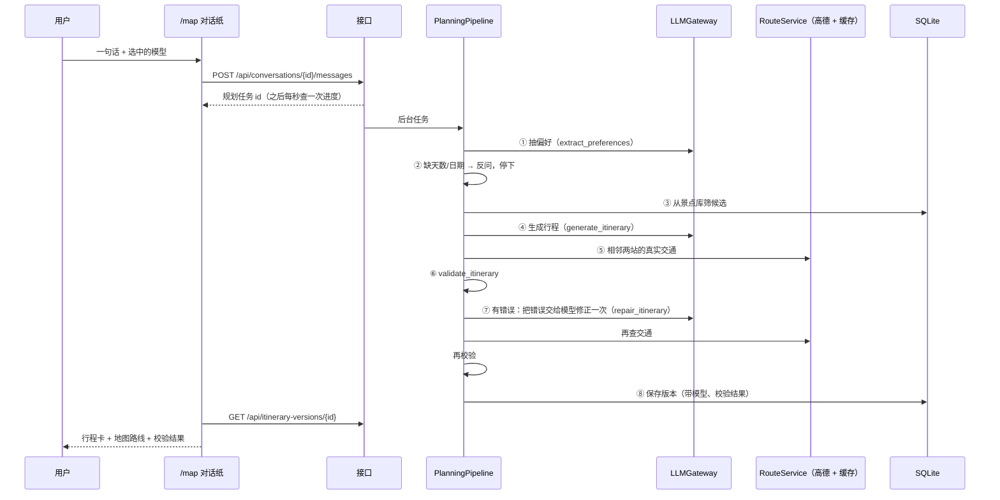

# AI Planning Pipeline

最后更新：2026-11-15（板块 5）。这份文件写的是代码现在的样子；规则和数值由 Cecilia 在 2026-11-15 确认。

## 目标

用户用日常语言说需求，得到一份**经过结构化数据校验**的逐日行程，显示在地图上。没通过校验的行程不当成合格的展示。

## 一句话分工

模型只做两件事：**听懂用户的话**（抽偏好），**在候选景点里挑景点、排时间**（生成行程）。
景点资料、交通时间、预约和支付提示都由程序从景点库和高德取；行程合不合格由程序（`validate_itinerary`）判断，不由模型判断。

原因：模型擅长理解语言、在兴趣、节奏和顺路之间取舍；但它说的开放时间、两地走多久、某个景点存不存在都可能是编的。所以事实类的东西不让它说，它排出来的东西都要被程序核对。

## 链路

| 步骤 | 输入 | 输出 | 谁做 | 代码 |
|---|---|---|---|---|
| ① 抽偏好 | 这条消息、之前的偏好、今天的日期 | `TravelerPreferences`：天数、日期、日期未定、节奏、兴趣、预算、同行人、交通偏好、必去、不去、其他要求 | 模型（网关按 schema 校验） | `preferences.py`、`prompts.py` |
| ② 判断够不够 | 偏好、问过什么 | 一句反问，或往下走 | 程序 | `preferences.question_for` |
| ③ 筛候选 | 偏好、景点库 | 候选清单（id、名字、区、类别、对得上哪些兴趣、开放时间、建议时长）、两两直线距离 | 程序 | `candidates.py`、`interests.py` |
| ④ 生成 | 偏好、候选清单 | `PlanDraft`：每天的主题，每站的 `poiId`、`arrive`、`leave`、`reason` | 模型 | `prompts.GENERATE_SYSTEM` |
| ⑤ 查交通 | 同一天相邻两站 | 每段的方式、真实分钟数、距离、费用、折线、查询时间 | 程序 | `transport.py` |
| ⑥ 校验 | 行程、候选、交通、日期、节奏、今天 | 错误、警告、状态 | 程序 | `validate.py` |
| ⑦ 修正 | 上一版行程、具体错误、真实交通时间 | 新行程 → 再做 ⑤ ⑥ | 模型 + 程序 | `prompts.REPAIR_SYSTEM` |
| ⑧ 保存 | 最终行程 | 一个不可变的行程版本 | 程序 | `pipeline.py`、`itinerary_repository.py` |

代码都在 `apps/api/app/services/planning/`，编排在 `pipeline.py`。所有模型调用都经过 `LLMGateway.complete_json`，用界面上选中的模型（每次请求指定，见 `llm-provider-gateway.md`）。"排行程"和"修正"是慢请求，超时直接报错、不重试（2026-11-15 Cecilia 定的）；限流和对方出错照样重试。

没有用模型的"工具调用"：链路的每一步都由程序决定什么时候查什么，模型只回答固定结构的 JSON。这样两个模型走的路完全一样，板块 6 对比时才公平；也不用担心模型跳过某个查询。

## ② 什么时候反问

- **天数**必须有，没有就问。
- **日期**问一次。用户说没定（`dateUndecided`），或者问过一次还是没说，就照样规划，校验时给"日期未定，闭馆日没法校验"的警告。日期已经过去的问一次。
- **节奏、交通偏好**没说就用默认值（适中、地铁公交优先），并写进 `defaultsUsed`，行程卡上列出来。
- 预算、同行人没说就在提示词里写"没说"。

## ③ 候选怎么筛

- 用户说不想去的去掉（按名字匹配）。
- 其余全部保留，按兴趣对得上的多少排序。景点库只有 10 个，规划策略要求候选至少是要排的景点数的 2 倍，所以现在不按兴趣砍景点。
- 用户点名想去、库里有的标"必去"；库里没有的告诉用户"不在景点库里，没有安排"，不让模型去编。
- 景点资料的 `tags` 现在全是空的，所以按类别对照兴趣（`interests.py`）。**这张表是 Claude 起草的判断规则，待 Cecilia 确认**：

| 类别 | 对得上的兴趣 |
|---|---|
| landmark 地标建筑 | 历史文化、老建筑、拍照 |
| museum 博物馆 | 历史文化、博物馆 |
| campus 大学 | 大学校园、老建筑、拍照 |
| park 公园湖泊 | 自然风光、拍照 |
| riverside 江滩 | 自然风光、城市漫步、夜景 |
| temple 寺庙 | 寺庙、历史文化、老建筑 |
| street 历史街区、步行街 | 城市漫步、老建筑、历史文化 |
| food-street 美食街 | 美食、城市漫步 |

## ⑤ 交通方式怎么选

由程序定，时间用高德的，不用模型说的（`transport.py`）：

1. 先查步行。步行 15 分钟以内（用户说"尽量走路"时 30 分钟以内）就走过去。
2. 否则按交通偏好：地铁公交优先、尽量走路 → 公交地铁；打车 → 驾车（打车）。
3. 高德说没有公交方案时改步行。
4. 查询出错时保留出错的结果，校验时给"交通没查到"的警告。

路线先查 SQLite 缓存（板块 3，步行 30 天、公交地铁 7 天、驾车 1 天），没过期不调用高德。

## ⑥ 校验规则（`validate_itinerary`）

纯函数，不调用模型、不联网，测试在 `tests/test_validate_itinerary.py`（30 个）。

**状态**：有一条错误是"未通过"（failed）；没有错误、有警告是"有警告"（warning）；都没有才是"通过"（passed）。

**错误**：

| code | 检查什么 |
|---|---|
| `unknown-poi` | `poiId` 不在候选里（包括用户说不想去的） |
| `duplicate-poi` | 同一个景点排了两次 |
| `day-count` / `day-number` | 天数不对 / 编号不是从 1 开始按顺序 |
| `empty-day` | 某天一个景点都没有 |
| `bad-time` / `time-order` | 时间不是 HH:MM / 离开不晚于到达 |
| `closed-day` | 那天是 `closedWeekdays` 里的闭馆日（备注一起显示，例如"法定节假日除外"；景点库里没有节假日日历，所以严格按闭馆日算） |
| `before-open` | 到达早于开门 |
| `after-last-entry` | 到达晚于最晚入场；没写最晚入场的，到达不早于关门 |
| `after-close` | 离开晚于关门 |
| `overlap` | 后一站到达早于前一站离开 |
| `transport-too-short` | 两站之间的空档短于高德给的真实交通时间 |
| `day-window` | 早于 08:00 开始或晚于 22:00 结束 |
| `day-too-long` | 第一站到达到最后一站离开超过上限：轻松 8 小时、适中 10 小时、紧凑 12 小时 |

一天有好几个开放时段时，落在任何一个时段里就算对；都不对时按问题最少的那个时段报。

**警告**（每条写明哪个景点、哪一项、为什么；`fields` 标出依据的是哪几项资料）：

| code | 什么情况 |
|---|---|
| `hours-unknown` | 开放时间是 TODO，或资料里没写那个月、那个星期几（资料没写不等于闭馆）。消息里写"开放时间未知，无法校验" |
| `date-unknown` | 日期未定 |
| `closed-day-unchecked` | 日期未定，而这个景点有固定闭馆日 |
| `route-unknown` | 交通没查到（高德出错、没有方案） |
| `route-stale` | 交通用的是过期的缓存 |
| `transport-tight` | 空档够，但比真实交通时间多出不到 10 分钟 |
| `stay-short` | 停留不到建议时长的一半 |
| `duration-unknown` | 没有建议游玩时长 |
| `data-expired` | 用到的开放时间、建议时长、预约、票价、支付过了有效期（每项一条） |
| `data-pending` | 用到的资料是占位，待确认（每个景点一条，列出哪几项） |
| `data-missing` | 预约、票价、支付没有资料（每个景点一条） |

数值在 `validate.py` 开头的常量里，改了要同步改这里。

**缺数据时的原则**：资料缺失不能当作通过，也不能当作错误（不能说景点闭馆），所以是警告"无法校验"。现在 10 个景点的资料全是占位，任何行程最好的结果是"有警告"。

## ⑦ 修正

第一轮有错误时，把每条错误的中文说明、程序查到的每段真实交通时间和上一版行程一起交给模型，让它只改有错的地方，重新输出完整行程；然后再查交通、再校验。只修正一次。还有错误就保存为 `failed`，回复里说明"不展示这份行程"，界面只显示问题清单，地图上不画。

## ⑧ 保存

每条消息产生的行程是同一份行程的新版本，版本号从 1 递增，存下后不再修改（表结构见 `data-model.md` 第 12 节）。版本里是快照：

- 景点资料（名字、坐标、开放时间、预约、票价、支付，连同当时的核实状态）；
- 每段交通（方式、分钟数、折线、查询时间、为什么选这种方式）；
- 校验结果、用的模型和真实模型名、修正了几轮、第一轮的结果；
- 模型最后一轮的原始输出（`draft`，没通过时用来对比）；
- 按默认补的设置（`defaultsUsed`）。

没通过校验的版本也存，标 `failed`：板块 6 比较两个模型时要用。分享页（板块 7）只允许"通过"和"有警告"的版本。

## 提示词

在 `prompts.py`，两个模型用同一套。要点：

- 抽偏好：只填用户说了的，不猜；兴趣只能从固定的十个里选；日期按"今天"换算。
- 生成：只能用候选的 id；每个景点一次；天数、时间格式、每天的时间窗和时长上限、开放时间和最晚入场、闭馆日、留够交通时间（给直线距离做参考，提醒实际路程更长）；`reason` 只写为什么这样排，不写开放时间、票价、交通时间这些事实；不写交通方式。
- 修正：在生成的要求之外，附上错误清单、真实交通时间和上一版。

## 模型

界面上选的模型跟着每条消息发给后端，链路里的每一次模型调用都用它（`provider` 参数）。版本里记 `planner.provider`、`planner.model`（对方返回的真实模型名）。豆包的深度思考 2026-11-15 由 Cecilia 决定关掉：开着时"排行程"每次都超过 60 秒的超时。开和关的效果可以用 `corepack pnpm plan:thinking` 比较（真实调用）。

## 测试

单元测试都不调用真实模型：

- `tests/test_validate_itinerary.py`：每条校验规则。
- `tests/test_planning_pipeline.py`：用假模型和假高德跑整条链路：反问、一次通过、修正后通过、修正后仍不通过、模型编出来的景点、不想去的景点、点名但库里没有的、交通方式、路线缓存、第二条消息产生第 2 版、选中的模型用于每次调用、模型出错。
- `tests/test_itinerary_storage.py`：版本和对话存进 SQLite。
- `tests/test_api.py`：接口。
- `tests/test_thinking_compare.py`：对比脚本怎么跑、打印什么。

## 还没做的

- 雨天备选、排队、预算约束、天气。
- 餐饮和住宿不在景点库里，行程里不安排。
- 规划任务只存在内存里，后端重启后正在跑的任务会丢（结果已存的不丢）。
