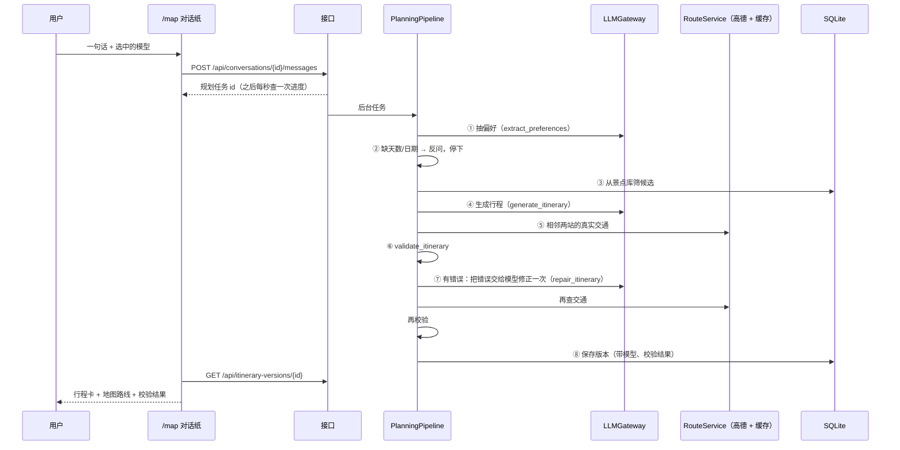

# AI Planning Pipeline

最后更新：2026-11-15（板块 5B：一次规划排三份侧重不同的方案；板块 6：双模型对比；板块 6B：排行程时给模型真实交通表；板块 6C：钟点由程序推）。这份文件写的是代码现在的样子；规则和数值由 Cecilia 在 2026-11-15 确认。

## 目标

用户用日常语言说需求，得到一份**经过结构化数据校验**的逐日行程，显示在地图上。没通过校验的行程不当成合格的展示。

## 一句话分工

模型只做两件事：**听懂用户的话**（抽偏好），**在候选景点里挑景点、定顺序和每站待多久**（生成行程）。钟点由程序按真实交通推（板块 6C，ADR 0007）。
景点资料、交通时间、预约和支付提示都由程序从景点库和高德取；行程合不合格由程序（`validate_itinerary`）判断，不由模型判断。

原因：模型擅长理解语言、在兴趣、节奏和顺路之间取舍；但它说的开放时间、两地走多久、某个景点存不存在都可能是编的。所以事实类的东西不让它说，它排出来的东西都要被程序核对。

## 链路



| 步骤 | 输入 | 输出 | 谁做 | 代码 |
|---|---|---|---|---|
| ① 抽偏好 | 这条消息、之前的偏好、今天的日期 | `TravelerPreferences`：天数、日期、日期未定、节奏、兴趣、预算、同行人、交通偏好、必去、不去、其他要求 | 模型（网关按 schema 校验） | `preferences.py`、`prompts.py` |
| ② 判断够不够 | 偏好、问过什么 | 一句反问，或往下走 | 程序 | `preferences.question_for` |
| ③ 筛候选 | 偏好、景点库、路线缓存 | 候选清单（id、名字、区、类别、对得上哪些兴趣、开放时间、建议时长）、两两之间的真实交通表（板块 6B，见 ⑤） | 程序 | `candidates.py`、`interests.py`、`transport.transit_table` |
| ④ 生成 | 偏好、候选清单、真实交通表 | `PlanOutline`：每天的主题和出发时间 `start`，每站的 `poiId`、`stayMinutes`、`reason`（板块 6C；之前是模型直接写 `arrive`、`leave`） | 模型 | `prompts.GENERATE_SYSTEM` |
| ⑤½ 推钟点 | 模型的行程、真实交通、开放时间 | `PlanDraft`：每站的 `arrive`、`leave`（见下面"推钟点"） | 程序 | `schedule.py` |
| ⑤ 查交通 | 同一天相邻两站 | 每段的方式、真实分钟数、距离、费用、折线、查询时间 | 程序 | `transport.py` |
| ⑥ 校验 | 行程、候选、交通、日期、节奏、今天 | 错误、警告、状态 | 程序 | `validate.py` |
| ⑦ 修正 | 模型上一版的行程、程序推出的钟点、具体错误、真实交通时间 | 新的 `PlanOutline` → 再做 ⑤ 推钟点 ⑥ | 模型 + 程序 | `prompts.REPAIR_SYSTEM` |
| ⑧ 保存 | 最终行程 | 一个不可变的行程版本 | 程序 | `pipeline.py`、`itinerary_repository.py` |

代码都在 `apps/api/app/services/planning/`，编排在 `pipeline.py`。所有模型调用都经过 `LLMGateway.complete_json`，用界面上选中的模型（每次请求指定，见 `llm-provider-gateway.md`）。"排行程"和"修正"是慢请求，超时直接报错、不重试（2026-11-15 Cecilia 定的）；限流和对方出错照样重试。

没有用模型的"工具调用"：链路的每一步都由程序决定什么时候查什么，模型只回答固定结构的 JSON。这样两个模型走的路完全一样，板块 6 对比时才公平；也不用担心模型跳过某个查询。

## 一轮三份方案（板块 5B）

同一个请求按三种侧重各排一份，三份各自走完 ④ 到 ⑦，再放在一起比较。2026-11-15 Cecilia 选的做法（ADR 0005）：**由程序先定每份的侧重和规则，再让模型分别排**，三份同时调用模型。不选"一次调用让模型出三份"（输出太长容易超时、一处 JSON 错三份一起作废、差别全靠模型自觉），也不选"程序排骨架、模型只写时间"（要写一套组合算法，景点只有 9 个，算出来的组合本来就很像）。

```text
抽偏好 → 反问？ → 共用候选（去掉暂停开放和用户不去的）
        ├─ 经典必去：候选 + 规则 → 模型排 ┐
        ├─ 轻松少走路：候选 + 规则 → 模型排 ├ 并行
        └─ 深度文化：候选 + 规则 → 模型排 ┘
→ 三份一份一份查交通（高德请求排队一个一个发）→ 通用校验 + 侧重规则
→ 去掉几乎一样的（不再花修正）→ 有错误的各修正一次（并行）→ 再查交通、再校验、再去重
→ 没通过的不展示 → 每份存成一个版本，记下这一轮
```

### 三种侧重（`emphasis.py`，数值是初值）

| 侧重 | 候选 | 节奏和交通 | 额外规则（不满足算错误，交给模型修正） |
|---|---|---|---|
| 经典必去 | 开放的景点全部；带"5A"标签的排前面。用户没点名必去时，5A 都标成必去（用户说不去的除外）；用户点名了必去时，只有用户点名的是必去（2026-11-15，评测 r07） | 用户的（没说按适中） | 标成必去的 5A 没排进去是错误；用户点名了必去时，没排进去的 5A 是警告（`emphasis-5a-skipped`），不交给模型修正 |
| 轻松少走路 | 和共用候选一样 | 节奏按"轻松"（每天最长 8 小时）；步行超过 10 分钟就改公交地铁或打车 | 每天最多 3 站；每天 17:30 前离开最后一站；每天站与站之间步行合计不超过 2 公里（步行段距离 + 公交地铁的换乘、进出站步行，即高德 transit 返回的 `walking_distance`）。不知道步行距离的段是警告 |
| 深度文化 | 只给有文化类标签的：历史、文物、近代建筑、民国建筑、欧式建筑、历史街区、老街（现在是黄鹤楼、省博、江汉路、黎黄陂路、昙华林、武大）；用户点名必去的也留着 | 用户的 | 每站停留不少于建议游玩时长（时长未知的不判断） |

三份共用用户说的天数、日期、必去、不去和交通偏好；暂停开放的古德寺不进任何一份的候选。"轻松少走路"改了节奏，所以它的 `defaultsUsed` 里不写共用的"节奏：适中（按默认）"，而写"节奏：轻松（这份是「轻松少走路」，按轻松排）"，用户说过别的节奏时再加"你说的是紧凑"；一轮记的 `defaultsUsed` 仍是三份共用的。每份的提示词多一段"【这份方案的侧重】"，写着上面的要求；校验出的侧重问题前面标着侧重名，例如"（轻松少走路）第 1 天排了 4 站……"。

### 几乎一样就不展示（`metrics.near_duplicate`）

两份用到的景点只差 0 或 1 个（一份比另一份多出来的不超过 1 个，换掉一个也算），并且每天最后一站的离开时间都相差不到 1 小时，就算几乎一样。按"经典必去 → 轻松少走路 → 深度文化"的顺序保留前面那份。第一轮排完先去重，几乎一样的不再花修正；修正后再去重一次。去掉的也存成版本，回复和对比卡上写明"和「经典必去」几乎一样：用到的景点相同，每天结束时间相差不到 1 小时"。

### 没通过、模型出错

- 修正一次后还有错误：不展示，原因写"没通过校验：还有 N 处问题（修正过一次）"，版本照样存（`failed`）。
- 某一份排行程时模型出错（超时、额度等）：只去掉这一份，原因写"模型没排出来：……"，没有版本；三份都出错才把错误报给用户。修正时出错：这份按没通过处理。
- 一份都没能展示：回复说明每份的原因，界面只显示第一份存下的版本的问题清单，地图上不画。

### 比较（`metrics.py`，全部由程序算）

保存每个版本时算好 `metrics`，`GET /api/planning-rounds/{id}` 再把展示的几份排成对比表：

| 行 | 怎么算 |
|---|---|
| 用了哪些景点、景点数 | 按顺序列出名字 |
| 交通时间合计，其中步行 / 公交地铁 / 打车 | 高德查到的分钟数；没查到的段不算，写"（N 段没查到）" |
| 步行距离 | 步行段的距离 + 公交地铁段的换乘步行距离，打车算 0；旧缓存里没有换乘步行距离的写"（N 段不详）"。不含景点里面走的路 |
| 门票（每人） | 成人日场全票（票名里带半票、优惠、学生、儿童、老人的跳过）；免费入园的算 0（东湖的 30 元观光车不算）；19:00 以后到达、资料里有夜场票的按夜场，夜场按星期几分价钱的按那天的星期选，日期未定写"120 或 150 元"；没有票价的写"不详"，总价标"不完整：…票价不详" |
| 第 N 天几点结束 | 最后一站的离开时间 |
| 校验 | 通过 / 有警告 / 未通过，几条错误、几条警告 |

表里不写"哪份更好"，只列数字。

### 一轮怎么存

一次规划是一"轮"（表 `planning_rounds`，见 `data-model.md` 第 12 节）：记下三份各是哪个行程的哪个版本、展示没有、不展示的原因。同一段对话里，同一侧重的方案是同一份行程，再发消息就排新的一轮，每份是它那份行程的下一个版本，旧的一轮保留；生成时把同一侧重上一轮的方案作为"上一版"给模型。

### 时间和调用次数

每轮模型调用 4 到 7 次：抽偏好 1 次、排行程 3 次（并行）、修正最多 3 次（并行）。三份同时调用，所以等待时间大约是一份的时间加上查交通；高德的路线预热后几乎不用再查（`corepack pnpm routes:prewarm`：9 个开放景点两两的步行和公交地铁，144 条，一个一个查；旧缓存的换乘步行距离从存着的原始返回里补，不发请求）。

## 双模型对比（板块 6）

同一个请求交给千问和豆包并排运行（`/compare` 页面和批量评测脚本），两边的输入只差模型（ADR 0006）。2026-11-15 Cecilia 确认的做法：

```text
请求 → 偏好（页面：默认模型抽一次，两边共用；批量评测：eval/requests.json 里手写的）
     ├─ 千问 plan_single ┐ 同时跑：同一份偏好、同一份候选、同一种侧重
     └─ 豆包 plan_single ┘ 各自：生成 → 查交通 → 校验（含侧重规则）→ 有错误修正一次 → 存版本
→ 每边的数字、两份的差异、对比表（model_compare.py）→ 存一次对比（model_comparisons）
```

- `PlanningPipeline.plan_single`：给定偏好、一种侧重、指定模型排一份。不抽偏好、不反问、不进对话；步骤和 `handle` 里的每一份一样（共用 `_generate`、`_repair`、`_check_all`、`_version_data`）。偏好里没有天数时报错，对比页让用户把天数写进请求。
- 编排在 `compare_runner.py`（`ModelComparer`）。两边用同一个链路对象，所以高德请求照样排队、同一份缓存。每边的模型调用用 `collect_calls()` 分开收集（见 `llm-provider-gateway.md`），抽偏好那次单独记。
- 给模型看的真实交通表先算一份，两边共用（见 ⑤ 的板块 6B 一段）。
- 一次对比调用模型 3 到 5 次：抽偏好 1 次（批量评测没有），每个模型排行程 1 次，有错误的各修正 1 次。

### 指标（`model_compare.py`，全部由程序算）

| 指标 | 怎么算 |
|---|---|
| 第一版是否通过 | 第一版校验没有错误（警告不算：资料还没核实，警告几乎免不了） |
| 第一版错误、警告各几条，错误类型 | 第一版的完整校验报告（版本里新存的 `firstValidation`），错误按 code 计数 |
| 修正后是否通过 | 最终版没有错误；第一版就通过的直接算通过 |
| 编造的景点 | 第一版里报 `unknown-poi` 的景点，id 在整个景点库里都找不到 |
| 候选以外的景点 | 第一版里报 `unknown-poi` 的景点，在库里但这次不能用（用户不去、暂停开放、侧重没给） |
| 景点数、交通时间（分方式）、步行距离、门票、每天几点结束、最终校验 | 5B 的 `plan_metrics` 和 `compare_plans`，原样复用 |
| 模型耗时 | 这一边每次模型调用的耗时相加（不含抽偏好） |
| 整体耗时 | 这一边从开始排到存版本（含查交通） |
| 调用次数、请求次数、token | 从调用记录汇总；请求次数含重试和让模型重答；没返回 token 的调用单独数出来 |

两份行程的差异：只有一边选了的景点、两边都选了的；同一天两边都有的景点先后顺序一样不一样（都有的不到 2 个时不比）；排在不同天的景点；5B 的"几乎一样"判断。

批量评测的汇总（`summarize`）：每个模型的首次通过率、修正后通过率（分母是全部运行，模型出错的也算）、第一版平均错误数、错误类型按次数排序、编造和候选以外景点出现的次数、平均耗时和 token（按排出来的运行平均）。汇总里写明局限，不写哪个模型更好。

## ② 什么时候反问

- **天数**必须有，没有就问。
- **日期**问一次。用户说没定（`dateUndecided`），或者问过一次还是没说，就照样规划，校验时给"日期未定，闭馆日没法校验"的警告。日期已经过去的问一次。
- **节奏、交通偏好**没说就用默认值（适中、地铁公交优先），并写进 `defaultsUsed`，行程卡上列出来。
- 预算、同行人没说就在提示词里写"没说"。

## ③ 候选怎么筛

- 暂停开放的去掉（景点资料里 `operatingStatus` 是 `closed-temporarily`，2026-11-15 加）。用户点名想去的话，在回复里告诉他现在暂停开放、没有安排。
- 用户说不想去的去掉（按名字匹配）。
- 其余全部保留，按兴趣对得上的多少排序。景点库只有 10 个，规划策略要求候选至少是要排的景点数的 2 倍，所以现在不按兴趣砍景点。
- 用户点名想去、库里有的标"必去"；库里没有的告诉用户"不在景点库里，没有安排"，不让模型去编。
- 景点资料的 `tags` 现在全是空的，所以按类别对照兴趣（`interests.py`）。**这张表是 Claude 起草的判断规则，待 Cecilia 确认**：

| 类别 | 对得上的兴趣 |
|---|---|
| landmark 地标建筑 | 历史文化、老建筑、拍照 |
| museum 博物馆 | 历史文化、博物馆 |
| campus 大学 | 大学校园、老建筑、拍照 |
| park 公园湖泊 | 自然风光、拍照 |
| riverside 江滩 | 自然风光、城市漫步、夜景 |
| temple 寺庙 | 寺庙、历史文化、老建筑 |
| street 历史街区、步行街 | 城市漫步、老建筑、历史文化 |
| food-street 美食街 | 美食、城市漫步 |

## ⑤ 交通方式怎么选

由程序定，时间用高德的，不用模型说的（`transport.py`）：

1. 先查步行。步行 15 分钟以内（用户说"尽量走路"时 30 分钟以内；"轻松少走路"那份 10 分钟以内）就走过去。
2. 否则按交通偏好：地铁公交优先、尽量走路 → 公交地铁；打车 → 驾车（打车）。
3. 高德说没有公交方案时改步行。
4. 查询出错时保留出错的结果，校验时给"交通没查到"的警告。

路线先查 SQLite 缓存（板块 3，步行 30 天、公交地铁 7 天、驾车 1 天），没过期不调用高德。

**排行程前的真实交通表（板块 6B，2026-11-15 Cecilia 定）**：第一次批量评测里两个模型最多的错误都是"交通时间不够"（千问 15 次、豆包 22 次），原因是模型只拿到直线距离，自己估时间。现在提示词里给的是候选两两之间、程序会选的方式和高德的分钟数（`transit_table`），例如 `a↔b 公交地铁 34 分钟`，来回不一样的分开写。

- 和校验用同一个判断（`decide_leg`，上面四条规则，侧重的步行上限也算），所以模型看到的时间就是校验时核对的时间。
- 只读缓存，不为这张表调用高德，不多等。缓存里没有的两站写"没查到真实时间，直线 X km"。路线预热后地铁公交优先和尽量走路的用户 36 对全有；打车的驾车缓存一天就过期、也没预热，大多数是直线距离。
- 效果（2026-11-15 第二次批量评测，每个模型 30 次）："交通时间不够"平均每次千问 1.50 条、豆包 2.17 条，和没有表时（1.50、2.20）差不多。错误处表里都写着正确的分钟数，模型留的空档还是 20、30 这样的整数，说明它们拿到时间也没按表算。下一步怎么做等 Cecilia 定（见 `docs/progress/current-progress.md`）。
- 双模型对比先算一份交通表，两边共用（`transit_for`）：两边同时跑，各算各的话，后开始的一边可能读到先开始的一边刚查进缓存的路线，提示词就不一样了。三份方案的提示词本来就是一起算好再并行调用的，不受影响。

## ⑥ 校验规则（`validate_itinerary`）

纯函数，不调用模型、不联网，测试在 `tests/test_validate_itinerary.py`（30 个）。

**状态**：有一条错误是"未通过"（failed）；没有错误、有警告是"有警告"（warning）；都没有才是"通过"（passed）。

**错误**：

| code | 检查什么 |
|---|---|
| `unknown-poi` | `poiId` 不在候选里（包括用户说不想去的、暂停开放的） |
| `poi-closed` | 景点现在暂停开放。暂停开放的景点本来就不进候选，这一条是多一道保险 |
| `duplicate-poi` | 同一个景点排了两次 |
| `day-count` / `day-number` | 天数不对 / 编号不是从 1 开始按顺序 |
| `empty-day` | 某天一个景点都没有 |
| `bad-time` / `time-order` | 时间不是 HH:MM / 离开不晚于到达 |
| `closed-day` | 那天是 `closedWeekdays` 里的闭馆日（备注一起显示，例如"法定节假日除外"；景点库里没有节假日日历，所以严格按闭馆日算） |
| `before-open` | 到达早于开门 |
| `after-last-entry` | 到达晚于最晚入场；没写最晚入场的，到达不早于关门 |
| `after-close` | 离开晚于关门 |
| `overlap` | 后一站到达早于前一站离开（板块 6C 起不会再出现） |
| `transport-too-short` | 两站之间的空档短于高德给的真实交通时间（板块 6C 起钟点由程序推，不会再出现；规则留着当保险） |
| `transport-unknown` | 板块 6C：相邻两站的交通没查到，程序推不出后面的钟点（`schedule.py` 报） |
| `day-overflow` | 板块 6C：按停留时长和交通推下来过了午夜（`schedule.py` 报） |
| `day-window` | 早于 08:00 开始或晚于 22:00 结束 |
| `day-too-long` | 第一站到达到最后一站离开超过上限：轻松 8 小时、适中 10 小时、紧凑 12 小时 |

一天有好几个开放时段时，落在任何一个时段里就算对；都不对时按问题最少的那个时段报。

**警告**（每条写明哪个景点、哪一项、为什么；`fields` 标出依据的是哪几项资料）：

| code | 什么情况 |
|---|---|
| `hours-unknown` | 开放时间是 TODO，或资料里没写那个月、那个星期几（资料没写不等于闭馆）。消息里写"开放时间未知，无法校验" |
| `date-unknown` | 日期未定 |
| `closed-day-unchecked` | 日期未定，而这个景点有固定闭馆日 |
| `route-unknown` | 交通没查到（高德出错、没有方案） |
| `route-stale` | 交通用的是过期的缓存 |
| `transport-tight` | 空档够，但比真实交通时间多出不到 10 分钟 |
| `stay-short` | 停留不到建议时长的一半 |
| `duration-unknown` | 没有建议游玩时长 |
| `data-expired` | 用到的开放时间、建议时长、预约、票价、支付过了有效期（每项一条） |
| `data-pending` | 用到的资料是占位，待确认（每个景点一条，列出哪几项） |
| `data-missing` | 预约、票价、支付没有资料（每个景点一条） |

数值在 `validate.py` 开头的常量里，改了要同步改这里。

**缺数据时的原则**：资料缺失不能当作通过，也不能当作错误（不能说景点闭馆），所以是警告"无法校验"。现在 10 个景点的资料全是占位，任何行程最好的结果是"有警告"。

## 推钟点（板块 6C，`schedule.py`）

2026-11-15 Cecilia 定（ADR 0007）。6B 给了模型真实交通表，第二次评测里"交通时间不够"还是平均每次千问 1.50 条、豆包 2.17 条：模型拿到时间也不按表算。所以钟点改由程序推：

1. 第一站到达 = 模型给的这天出发时间 `start`。
2. 后一站到达 = 前一站离开 + 真实交通分钟数（⑤ 查到的那一段，和校验用的同一段）+ 10 分钟，往后取整到 5 分钟。
3. 到得比开门早就等到开门（有午休的按下午时段）；开放时间未知的不等；闭馆日不等，交给校验报"闭馆"。
4. 离开 = 到达 + `stayMinutes`。
5. 交通没查到：`transport-unknown` 错误，后面的站不再推；推过了午夜：`day-overflow` 错误。

推好的行程照常校验。"交通时间不够""时间重叠"不会再出现，错误集中在开放时间、最晚入场、闭馆日、每天总时长和侧重规则上，这些仍要模型改（换顺序、换站、改停留时长或出发时间）。版本里存模型给的 `outline` 和程序推出的 `draft`。

## ⑦ 修正

每份方案各自修正（板块 5B：三份并行，几乎一样被去掉的不修正）。第一轮有错误时，把每条错误的中文说明、程序查到的每段真实交通时间、模型上一版给的行程和程序推出的钟点一起交给模型，让它只改有错的地方，重新输出完整行程（出发时间、顺序、停留时长；板块 6C）；然后再查交通、推钟点、再校验。只修正一次。还有错误就保存为 `failed`，回复里说明"不展示这份行程"，界面只显示问题清单，地图上不画。

## ⑧ 保存

板块 5B 起每条消息产生一轮三份，每份是它那份行程（同一侧重）的新版本，这一轮记在 `planning_rounds`（见上面"一轮怎么存"）。以下说的是一个版本。

每条消息产生的行程是同一份行程的新版本，版本号从 1 递增，存下后不再修改（表结构见 `data-model.md` 第 12 节）。版本里是快照：

- 景点资料（名字、坐标、开放时间、预约、票价、支付，连同当时的核实状态）；
- 每段交通（方式、分钟数、折线、查询时间、为什么选这种方式）；
- 校验结果、用的模型和真实模型名、修正了几轮、第一轮的结果；
- 模型最后一轮的原始输出（`draft`，没通过时用来对比）；
- 按默认补的设置（`defaultsUsed`）；
- 板块 5B：这份的侧重（`emphasis`）和程序算的数字（`metrics`）。

没通过校验的版本也存，标 `failed`：板块 6 比较两个模型时要用。分享页（板块 7）只允许"通过"和"有警告"的版本。

## 提示词

在 `prompts.py`，两个模型用同一套。要点：

- 抽偏好：只填用户说了的，不猜；兴趣只能从固定的十个里选；日期按"今天"换算。
- 生成（板块 6C）：只能用候选的 id；每个景点一次；天数；每天写出发时间、每站写停留分钟数，不写钟点；讲清楚程序怎么推钟点，让模型自己推一遍，保证每天的时间窗和时长上限、开放时间和最晚入场、闭馆日；用真实交通表决定顺序和一天放几站（表里没查到的才给直线距离）；`reason` 只写为什么这样排，不写开放时间、票价、交通时间这些事实；不写交通方式。
- 修正：在生成的要求之外，附上错误清单、真实交通时间和上一版。
- 语言（中英双语，ADR 0009）：规则仍用中文写。用户在英文网站上发的消息，生成和修正的系统提示词后面多一句"title、theme、reason 一律用英文写"（`prompts.language_rule()`），候选清单里的景点名用英文译文。两个模型看到的是同一套规则。

## 语言（中英双语，ADR 0009）

- 任务按发消息时的语言跑（`app/core/lang.py` 的 contextvar，`run_in_lang`）。反问、校验说明、侧重规则的说明、按默认补的设置、交通方式说明（`leg.choice`）、方案对比表、出错提示都按这个语言写，写进版本和对话后不再变。
- 判断逻辑不随语言变：候选、兴趣、侧重规则（5A、文化类标签）都按中文资料算；用户点名必去、不去的景点同时按中文名和英文名匹配。
- 存进版本的景点名、区、资料用当前语言（英文用译文）。门票计算认得英文票名里的 night、half、student、Mon–Thu 这些说法。
- 校验错误交给模型修正时也是这种语言，模型照样能读。

## 模型

界面上选的模型跟着每条消息发给后端，链路里的每一次模型调用都用它（`provider` 参数）。版本里记 `planner.provider`、`planner.model`（对方返回的真实模型名）。豆包的深度思考 2026-11-15 由 Cecilia 决定关掉：开着时"排行程"每次都超过 60 秒的超时。开和关的效果可以用 `corepack pnpm plan:thinking` 比较（真实调用）。

## 测试

单元测试都不调用真实模型：

- `tests/test_validate_itinerary.py`：每条校验规则。
- `tests/test_planning_pipeline.py`：用假模型和假高德跑整条链路：反问、一次通过、修正后通过、修正后仍不通过、模型编出来的景点、不想去的景点、点名但库里没有的、交通方式、路线缓存、第二条消息产生第 2 版、选中的模型用于每次调用、模型出错。
- `tests/test_itinerary_storage.py`：版本和对话存进 SQLite。
- `tests/test_api.py`：接口。
- `tests/test_thinking_compare.py`：对比脚本怎么跑、打印什么（脚本只排"经典必去"一份，和板块 5 跑过的结果可比）。
- 板块 6B：`tests/test_transit_table.py`（交通表和校验选的方式一样、步行上限、只读缓存不调用高德、没缓存写直线、过期和出错的不用）。
- 板块 6：`tests/test_model_compare.py`（每边的指标、编造和候选以外分开、差异、对比表、汇总）、`tests/test_plan_single.py`（给定偏好排一份、两个模型并行时调用记录分开）、`tests/test_model_comparisons.py`（整条对比流程和接口）、`tests/test_model_eval.py`（批量评测脚本）。
- 板块 5B：`tests/test_plan_metrics.py`（交通分方式、步行距离、门票日场夜场、几乎一样、对比表）、`tests/test_emphasis.py`（三种侧重的候选、节奏和规则）、`tests/test_planning_rounds.py`（一轮三份：并行生成、去重不修正、侧重规则触发修正、没通过不展示、一份模型出错、新的一轮、轻松那份步行超过 10 分钟坐车）、`tests/test_route_prewarm.py`。`tests/test_planning_pipeline.py` 里板块 5 的测试只排"经典必去"一份。

## 还没做的

板块 5B 这次只做了多份方案和比较（2026-11-15 Cecilia 定的范围）。下面这些留到以后：

- 更多偏好（每天几点出门、少走路、想吃的、住在哪一带：Cecilia 选了用高德查酒店地址）；
- 每份方案的取舍和风险；
- 留出吃饭和休息时间、引用景点库里的附近吃的；
- 在一份方案上继续改出新版本（现在再发消息是三份都重新排）；
- 每站的理由附上依据的数据；
- 每站可以换成哪些景点。

其余：

- 雨天备选、排队、预算约束、天气。
- 餐饮和住宿不在景点库里，行程里不安排。
- 规划任务只存在内存里，后端重启后正在跑的任务会丢（结果已存的不丢）。
