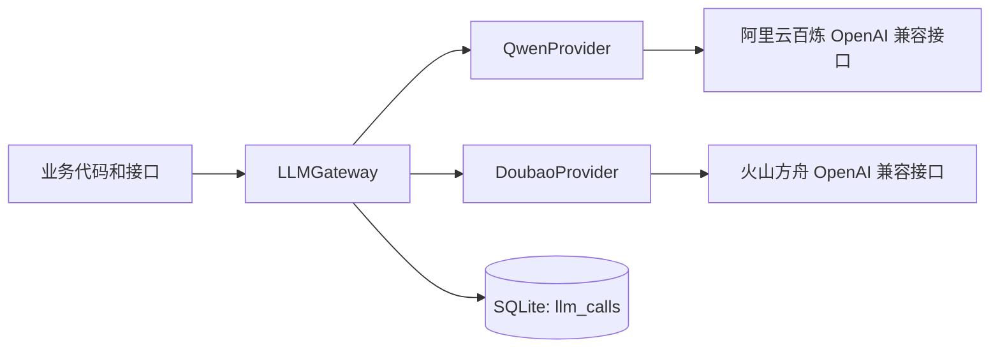

# LLM Provider Gateway

最后更新：2026-11-15（板块 4：千问和豆包真实接入）。这份文件写的是代码现在的样子。

## 目标

WuhanMemory 同时支持通义千问和豆包，可以切换。业务代码只认 `LLMGateway`，不直接碰任何一家的接口、字段名或错误格式。

## 结构



分两层，各管各的：

| 层 | 管什么 | 代码 |
|---|---|---|
| 网关 `LLMGateway` | 选模型、超时、重试、限流等待、检查输出、让模型重答、记录 | `apps/api/app/services/llm/gateway.py` |
| provider | 发一次请求；把对方的错误翻译成我们的错误类型 | `apps/api/app/services/llm/providers.py` |

其余文件：`base.py`（两层之间传的数据结构）、`errors.py`（错误类型）、`factory.py`（按 `.env` 建网关，`get_llm_gateway()`）。

provider 很薄，所以测试里可以用一个假的 provider 代替它，重试、超时、修复这些逻辑都不用联网就能测。

## 网关的接口

```python
result = await gateway.complete_json(
    task="extract_preferences",   # 这次调用的用途，只用于记录
    system_prompt="...",
    user_prompt="...",
    schema=TravelerPreferences,   # 可选：Pydantic 模型，输出要通过它的校验
    provider="doubao",            # 可选：不填用默认模型
)
result.payload   # 解析出来的 JSON 对象（dict）
result.parsed    # 给了 schema 时，校验通过的对象
result.provider  # 实际用的模型：qwen / doubao
result.model     # 对方返回的真实模型名
result.record    # 这次调用的记录
```

一次 `complete_json` 的过程：

1. **选模型**。请求里指定了就用指定的；没指定用 `.env` 里 `LLM_PROVIDER` 的默认模型。名字不在清单里报 `unknown_provider`；没配 key 或模型名报 `not_configured`，不发请求。
2. **发请求**。网关在系统提示词后面加一句"只输出一个 JSON 对象……"，两个模型用同一句。超过 `LLM_REQUEST_TIMEOUT_SECONDS`（默认 60 秒）算超时。
3. **出错时**。超时、限流、对方服务器出错、网络断开会重试，最多 `LLM_MAX_RETRIES` 次（默认 2 次），间隔 1 秒、2 秒。限流时对方用 `Retry-After` 头说了等多久就等多久，最多 20 秒；没说就按 1 秒、2 秒。其他错误不重试，直接报。
4. **检查输出**。必须是一个 JSON 对象；给了 `schema` 还要通过校验。外面包着 Markdown 代码块的，先剥掉再解析。
5. **修复**。输出不合格（不是 JSON、被截断、是空的、字段不符合 schema）时，把模型上一次的输出和哪里不对一起发回去，让它重答一次。还不合格就报 `bad_output`，最后一次的原文留在错误对象的 `raw_output` 上。
6. **记录**。成功失败都写一条到 SQLite 的 `llm_calls`，同时写一行日志。

## 切换模型

三个层次，后面的盖过前面的：

1. `.env` 里的 `LLM_PROVIDER`：默认模型，`qwen` 或 `doubao`。改了要重启后端。
2. 每次请求的 `provider` 参数：接口把前端传来的模型名原样交给网关。
3. 界面：`/map` 对话纸上的模型选择，选的是第 2 条里的那个参数。清单来自 `GET /api/llm/providers`，没配置的模型选不了。

切换只是"按名字从清单里取出另一个 provider"，提示词、输出检查、重试规则、返回的数据结构全都不变，所以业务代码不用为换模型写任何分支。

**自动换备用模型**（默认关，2026-11-15 Cecilia 定的）：`LLM_PROVIDER_MODE=fallback` 加上 `LLM_FALLBACK_PROVIDER` 时，没指定模型的请求在默认模型失败后会换到备用模型，两个模型各留一条记录。请求里指定了模型的，永远不会被换掉。默认关着是因为悄悄换模型会让"这次用了哪个模型"说不清，也会搅乱双模型对比。

## 两家不一样的地方

两家都走 OpenAI 兼容的 `/chat/completions`，请求和返回的大结构一样。差别收在各自的 provider 类里：

| 方面 | 通义千问（百炼） | 豆包（火山方舟） | 怎么处理 |
|---|---|---|---|
| 模型怎么指定 | 模型名，如 `qwen-plus` | 推理接入点 ID（`ep-` 开头）；返回里的 `model` 才是真实模型名 | 记录用返回里的模型名；接入点 ID 不给前端 |
| JSON 输出模式 | 支持；提示词里必须出现 "json" | 支持，但要看模型，官方标着 beta | 都带 `response_format: json_object`；对方说不支持时去掉这个参数再发一次并记住 |
| 深度思考 | `qwen-plus` 默认不思考 | 现在的接入点默认思考，回答里多一个 `reasoning_content` | `DOUBAO_THINKING` 留空用模型默认值，可设 `enabled` / `disabled`；只取 `content` |
| 错误码 | 同一种错有两种写法（`InvalidApiKey` / `invalid_api_key`） | 自己的一套（`AuthenticationError` 等） | 各自的对照表，翻译成同一组错误类型 |
| 额度用完 | 有的报 429，有的报 403 | 报 429（和限流同一个状态码） | 按错误码分出来，归为 `quota_exhausted`，不重试 |
| 内容审核 | `data_inspection_failed` | `SensitiveContentDetected` 等 | 归为 `content_blocked`，不重试 |

错误码对照表按两家官方错误码文档写（2026-11-15 查阅），网址在 `providers.py` 开头。千问那页很长，后半部分是按摘要对的。

2026-11-15 用真实调用确认过的：千问 `qwen-plus` 和豆包 `doubao-seed-2-1-pro-260915` 都接受 JSON 输出模式；豆包这个模型接受 `thinking: disabled`；豆包默认开着思考。Cecilia 决定豆包保持模型默认（开着思考）。

还没在真实接口上见过的：对方说"不支持 `response_format`"时的报错原文。现在的判断依据是 400 的说明里提到这个参数。

## 错误类型

| `code` | 含义 | 会不会重试 |
|---|---|---|
| `unknown_provider` | 指定的模型不在清单里 | 不会 |
| `not_configured` | 没配 key 或模型名 | 不会 |
| `invalid_key` | key 无效或没有权限 | 不会 |
| `bad_config` | 模型名或接入点填错 | 不会 |
| `quota_exhausted` | 额度用完或账户欠费 | 不会 |
| `content_blocked` | 被对方的内容审核拦下 | 不会 |
| `bad_request` | 对方认为请求有问题 | 不会 |
| `rate_limited` | 限流 | 会，先等一会儿 |
| `timeout` | 规定时间内没有回答 | 会 |
| `upstream_error` | 对方服务器出错或网络断开 | 会 |
| `bad_output` | 让模型重答一次后输出仍不合格 | 已经重答过一次 |
| `provider_error` | 对方返回的结构和预期不一样 | 不会 |

接口怎么把这些错误返回给前端，见 `api-contracts.md` 的"模型：出错时"。

## key 的安全

- key 只在 `apps/api/.env`（不进 git），只出现在发给对方的请求头里。
- 错误信息里引用对方返回的内容之前，先把 key 换成 `***`，并截短到 200 字以内。
- 没预料到的异常只记类型名，不记内容。
- provider 对象的 `repr` 不带 key。
- 接口不返回 key，也不返回豆包的接入点 ID；前端只知道"配没配置"。
- 调用记录不存提示词和回答。
- 这几条都有测试（`test_llm_providers.py` 里"key 不能漏出去"一组，`test_llm_calls.py`，`test_llm_api.py`）。

## 调用记录

每次 `complete_json` 写一行：用途、模型、真实模型名、开始时间、总耗时、一共发了几次请求、是否重试过、是否让模型重答过、成功或错误类型、token 数。表结构见 `data-model.md` 第 11 节。板块 6 的双模型对比从这里取数。

## 配置

```text
LLM_PROVIDER=qwen                 # 默认模型：qwen 或 doubao
LLM_REQUEST_TIMEOUT_SECONDS=60
LLM_MAX_RETRIES=2
LLM_FALLBACK_PROVIDER=            # 自动换备用模型，默认不开
LLM_PROVIDER_MODE=fixed           # 改成 fallback 才开

QWEN_API_KEY=
QWEN_BASE_URL=https://dashscope.aliyuncs.com/compatible-mode/v1
QWEN_MODEL=qwen-plus

DOUBAO_API_KEY=
DOUBAO_BASE_URL=https://ark.cn-beijing.volces.com/api/v3
DOUBAO_MODEL=                     # 推理接入点 ID，ep- 开头
DOUBAO_THINKING=                  # 留空用模型默认值；enabled / disabled
```

`.env` 是后端启动时读的，改了要重启后端。

## 测试

单元测试都不调用真实接口：

- `tests/test_llm_gateway.py`：用假 provider（`tests/llm_fakes.py`）测切换、重试、限流等待、超时、输出修复、记录。
- `tests/test_llm_providers.py`：用 httpx 的 `MockTransport` 代替对方的服务器，测请求内容、错误码翻译、key 不外漏。
- `tests/test_llm_calls.py`：记录写进 SQLite。
- `tests/test_llm_api.py`：接口。
- `tests/test_llm_smoke.py`：冒烟脚本打印什么、返回什么。

真实接口用冒烟脚本测（会花一点 token）：

```bash
cd ~/WuhanMemory-project2 && corepack pnpm llm:smoke
```

给两个模型各发同一条简单请求，打印是否成功、耗时、模型名、是否重试和修复。两个都成功时退出码是 0。

## 还没做的

- **工具调用**（`complete_with_tools`）：早期设计里有，代码里没有。板块 5 定规划链路时再决定要不要。
- **shadow 模式**（主模型回答用户，同时让另一个模型在后台跑）：没有做。两个模型并排比较是板块 6 的对比页，用每次请求指定模型的方式实现。
- **流式输出**：没有做。
- 早期设计里列的 Prometheus 风格指标没有做，现在用 `llm_calls` 表。
