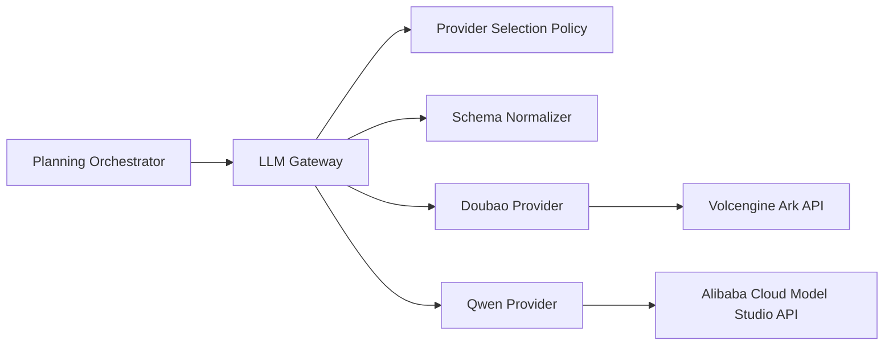

# LLM Provider Gateway

## 目标

WuhanMemory 需要同时支持豆包和 Qwen，并允许按环境变量、用户配置或故障降级切换模型。业务层不能直接依赖某一家模型 API 的 SDK、字段命名或错误格式。

## 结论

新增 `LLMGateway` 作为后端 AI 编排层的唯一入口。



## Provider 选择策略

支持三种模式:

- `fixed`: 固定使用 `doubao` 或 `qwen`。
- `fallback`: 主 provider 失败后自动切到备用 provider。
- `shadow`: 主 provider 返回用户结果，同时异步调用备用 provider 做质量对比，不影响用户体验。

MVP 默认:

```text
LLM_PROVIDER=mock
LLM_FALLBACK_PROVIDER=
LLM_PROVIDER_MODE=fixed
```

真实环境推荐:

```text
LLM_PROVIDER=qwen
LLM_FALLBACK_PROVIDER=doubao
LLM_PROVIDER_MODE=fallback
```

## 统一接口

```python
class LLMProvider(Protocol):
    name: str

    async def complete_json(
        self,
        *,
        system_prompt: str,
        user_prompt: str,
        schema: dict,
        temperature: float = 0.2,
        trace_id: str,
    ) -> LLMJsonResult:
        ...

    async def complete_with_tools(
        self,
        *,
        messages: list[LLMMessage],
        tools: list[LLMTool],
        tool_choice: str | dict = "auto",
        temperature: float = 0.2,
        trace_id: str,
    ) -> LLMToolResult:
        ...
```

## Provider 实现

### Qwen Provider

- 使用阿里云百炼/Model Studio 的 OpenAI 兼容接口。
- 支持 DashScope API Key。
- 用于偏好提取、行程生成、内容摘要和工具调用。

### Doubao Provider

- 使用火山方舟/豆包的 OpenAI 兼容接口。
- 支持 Ark API Key。
- 用于与 Qwen 同等任务，并作为 fallback 或 shadow provider。

## 结构化输出策略

模型输出按以下顺序处理:

1. 优先使用 provider 原生或 OpenAI 兼容的 JSON/structured output 能力。
2. 通过 Pydantic schema 做强校验。
3. 校验失败时进入一次 `repair_json` 调用，要求模型只修复 JSON，不改变语义。
4. 仍失败则返回 `LLM_SCHEMA_VALIDATION_FAILED`，并保留原始响应用于调试。

业务层只接收通过校验的 `TravelerPreferences`、`ItineraryDraft`、`ContentSummary` 等对象。

## 工具调用策略

- 工具 schema 集中定义，模型只能请求预注册工具。
- 工具参数先做 Pydantic 校验，再进入真实服务。
- 工具结果写入 job trace，便于复盘和对比不同 provider 的表现。

## 配置

```text
LLM_PROVIDER=mock
LLM_FALLBACK_PROVIDER=
LLM_PROVIDER_MODE=fixed

QWEN_API_KEY=
QWEN_BASE_URL=https://dashscope.aliyuncs.com/compatible-mode/v1
QWEN_MODEL=qwen-plus

DOUBAO_API_KEY=
DOUBAO_BASE_URL=https://ark.cn-beijing.volces.com/api/v3
DOUBAO_MODEL=

LLM_REQUEST_TIMEOUT_SECONDS=60
LLM_MAX_RETRIES=2
```

`DOUBAO_MODEL` 需要填写火山方舟控制台中的具体 endpoint/model id。

## 观测指标

- `llm_request_total{provider,model,task,status}`
- `llm_latency_ms{provider,model,task}`
- `llm_schema_validation_failed_total{provider,model,task}`
- `llm_fallback_total{from_provider,to_provider,reason}`
- `llm_token_usage{provider,model,task,type}`

## 测试策略

- Provider 单元测试使用 mock HTTP 响应，不依赖真实 key。
- Gateway 测试覆盖 fixed、fallback、shadow 三种选择策略。
- Schema repair 测试覆盖缺字段、错误 enum、非 JSON 文本包裹等情况。
- E2E 测试默认使用 mock provider，真实 provider 测试只在有 key 的环境运行。
