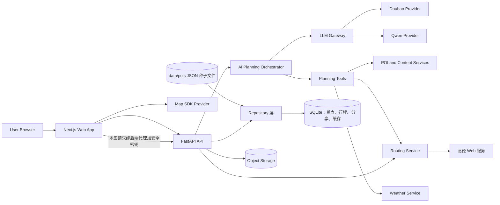

# System Architecture

## 总体架构



## 推荐仓库结构

```text
apps/
  web/
    app/            每个页面一个文件夹，页面自己的组件和样式放在一起
    components/
      ui/           基础组件（按钮、纸、印章、输入框）
      shell/        外壳（四角标注、菜单、空页面）
    lib/            页面清单、景点数据入口
  api/
    app/
      api/
      core/
      models/
      repositories/
      services/
      workers/
      schemas/
packages/
  shared/
    schemas/
    types/
  ui/
  map-core/
infra/
  docker/
  migrations/
docs/
```

## 前端边界

前端负责:

- AI 对话输入、流式状态展示和缺失信息补问。
- 地图渲染、2D/3D 切换、路线动画、景点卡片和每日筛选。
- 行程时间线、交通段、预算、预约和支付提示展示。
- 分享页静态化或半静态化展示。

前端不负责:

- 直接调用私密第三方 API key。
- 自行做可信路线规划和开放时间校验。
- 将 AI 文本当作最终路线数据。

## 后端边界

后端负责:

- 用户会话和旅行规划请求管理。
- AI 编排、工具调用、结构化输出校验。
- POI、路线、天气、内容和媒体数据聚合。
- 行程版本管理、分享页生成和权限控制。
- 缓存、限流、审计、观测和错误恢复。

## 地图 Provider 抽象

使用 `packages/map-core` 定义统一接口（2026-11-15 板块 3 改成现在的样子）:

```ts
export interface MapProvider {
  mount(container: HTMLElement, options: MapInitOptions): Promise<void>;
  setMode(mode: "2d" | "3d"): void;
  setPins(pins: MapPin[]): void;                        // 景点图钉
  onPinSelect(handler: (pinId: string | null) => void): void;
  openCard(pinId: string, content: HTMLElement): void;  // 图钉上方的卡片，内容由页面画
  closeCard(): void;
  setRoutes(routes: MapRoute[]): void;                  // 路线折线，dayNumber 用来按天分色
  focusBounds(bounds: MapBounds): void;
  destroy(): void;
}
```

坐标一律 GCJ-02。高德的实现在 `apps/web/lib/map/amap-provider.ts`：

- 浏览器只有 JS key（`NEXT_PUBLIC_AMAP_JS_KEY`）。安全密钥只在后端，地图请求经过后端的 `/_AMapService` 代理时由后端加上（高德官方推荐的做法）。
- 地图一直用 `viewMode: "3D"` 创建：2D 是俯仰角 0、不许拖动俯仰和旋转，3D 是俯仰角 50 度。手机上默认 2D。
- 配色用高德自带的"幻影黑"（`amap://styles/dark`）。

MVP provider:

- `AmapProvider`: 高德 JS API 2.0，适合武汉和中国境内 POI、路线、公交、地理编码场景。

后续 provider:

- `MapboxProvider`: 更强的全球化视觉和 3D 建筑。
- `CesiumProvider`: 更强的真实三维地球、倾斜摄影和大型地理数据能力。

## 核心服务

### Conversation Service

- 保存用户消息、AI 消息、补问状态和偏好提取结果。
- 支持流式响应和规划任务状态轮询。

### Planning Orchestrator

- 将自然语言需求转成结构化约束。
- 通过 `LLMGateway` 调用豆包、Qwen 或 mock provider。
- 调用 POI、路线、天气、内容检索和预算工具。
- 生成候选路线，排序后输出可验证的 itinerary JSON。

### LLM Gateway

- 对业务层提供统一 `complete_json` 和 `complete_with_tools` 接口。
- 支持 `qwen`、`doubao` 和 `mock` provider。
- 支持 fixed、fallback 和 shadow provider 选择策略。
- 统一结构化输出校验、错误码、token usage、latency 和 trace。

### POI Service

- 统一外部 POI 查询、内部 POI 缓存和人工精选内容。
- 维护坐标、分类、营业时间、门票、预约、适合人群、标签和来源。

### Routing Service

- 代码在 `apps/api/app/services/routing/`，接口 `GET /api/routes/compare`、`GET /api/routes`（见 api-contracts.md）。
- `RouteProvider` 是可替换的边界，现在的实现 `AmapRouteProvider` 调用高德路径规划 2.0（步行、公交地铁、驾车）。
- 结果缓存在 SQLite 的 `route_cache` 表，带 `checkedAt` 和 `expiresAt`：步行 30 天、公交地铁 7 天、驾车 1 天，过期重查（见 data-model.md 第 10 节）。
- 高德个人 key 的每秒请求数低：请求一个一个发、之间留间隔，被限流时等一下重试一次。

### Content Service

- 为景点生成或聚合简介、历史文化、拍照机位、注意事项和评价摘要。
- 所有生成内容保留来源、更新时间和置信度。

### Share Service

- 将某个行程版本发布为只读分享页。
- 支持公开链接、过期时间、撤回和访问统计。

## 典型数据流

1. `POST /api/conversations` 创建对话。
2. `POST /api/conversations/{id}/messages` 发送用户需求。
3. API 创建 `planning_job`，返回 job id 并流式返回理解过程。
4. Worker 执行 AI 规划和工具调用。
5. 规划结果写入 `itinerary_versions`。
6. 前端通过 WebSocket/SSE 或轮询拿到结构化结果。
7. 地图层渲染 POI 点位、路线和每日行程。
8. 用户修改后生成新版本，不覆盖旧版本。

## 可靠性原则

- AI 输出必须经过 JSON Schema 校验。
- LLM provider 切换不能改变业务层 schema。
- 每个 POI 必须有坐标、来源和更新时间。
- 每个交通段必须有起终点、交通方式、预计耗时和来源。
- 路线、开放时间、价格等动态信息需要 TTL。
- 分享页绑定 itinerary version，避免后续编辑影响已分享链接。
